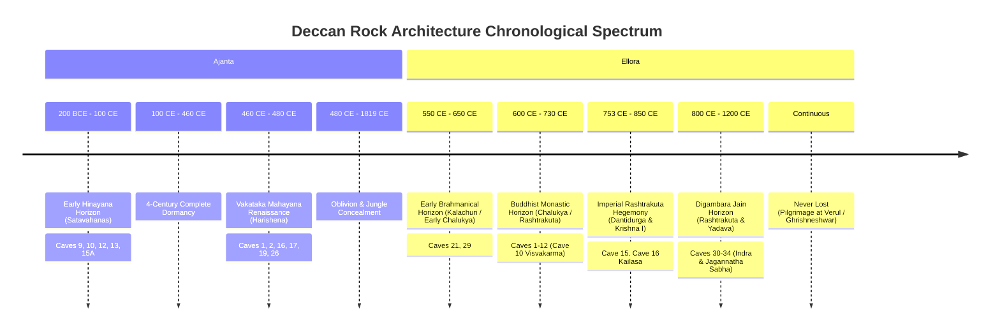

# Ajanta and Ellora: The Definitive Synthesis
### Chronology, Engineering Lithology, Political Economy, Painting Chemistry, and Rediscovery
*A Comprehensive Archaeological, Structural, and Production Treatise Combining Gemini & ChatGPT Research*

---

## Executive Summary

The rock-cut architectural complexes of **Ajanta** and **Ellora**, carved into the volcanic basalt scarps of the Sahyadri ranges in Maharashtra, India, represent over a millennium of uninterrupted architectural, geotechnical, and artistic mastery spanning from the 2nd century BCE to the 12th century CE. While frequently mentioned together as twin monuments of ancient Indian rock-cut architecture, their historical lifecycles, religious purposes, structural philosophies, and rediscovery trajectories present striking contrasts:

*   **Ajanta (exclusively Buddhist)**: Comprises 30 rock-cut caves (29 finished, 1 unfinished) sculpted into a secluded, 75-meter-high, horseshoe-shaped cliff above the Waghur (Waghora) River gorge. It developed across two sharply defined, non-continuous horizons separated by four centuries of dormancy: an early **Hinayana (Theravada)** phase (c. 2nd century BCE – 1st century CE) under the Satavahana dynasty, followed by a meteoric **Mahayana** renaissance (c. 460–480 CE) under the Vakataka Emperor Harishena. Following Harishena's sudden death and regional political disintegration, Ajanta was abruptly abandoned, sealed by colluvial landslides and dense teak jungle for over 1,300 years, and preserved as a pristine subterranean time capsule until its dramatic rediscovery by a British hunting party in 1819.
*   **Ellora / Verul (tri-faith: Buddhist, Hindu, Jain)**: Extends linearly for over two kilometers along the Charanandri hills scarp, containing 34 primary caves open to the public and nearly 100 minor excavations. Unlike Ajanta, Ellora was executed in an unbroken developmental continuum from c. 550 CE to the 12th century CE, transitioning across early Brahmanical/Hindu shrines (Kalachuri/Chalukya), grand multi-story Buddhist viharas and chaityas (Chalukya/Rashtrakuta), the zenith of monolithic stone architecture in the imperial Rashtrakuta **Kailasa Temple (Cave 16)**, and finishing with elaborate Digambara Jain complexes (Rashtrakuta/Yadava). Ellora was never lost to human memory; it remained an active pilgrimage and trade crossroads throughout the medieval era, documented by Arab geographers, Sultanate rulers, and European travelers, and withstood a protracted late-17th-century demolition attempt by the Mughal Emperor Aurangzeb.

This unified document synthesizes the historical, epigraphic, chemical, geological, and documentary production research from both specialist reports. It provides a complete, multi-layered reference for historians, conservation architects, structural engineers, and cinematic documentary creators.

---

## 1. Dynastic Chronology & Political Geography

The rock-cut sanctuaries were not isolated wilderness retreats; they were major geopolitical and economic hubs sustained by imperial statecraft, royal rivalries, and international trade routes.



### Ajanta: The Two Horizons
1.  **Phase I — Early Hinayana Horizon (c. 2nd Century BCE – 1st Century CE)**:
    *   **Sovereignty**: Satavahana Dynasty.
    *   **Excavations**: Caves 9 and 10 (apsidal *chaitya-grihas* or congregational prayer halls) and Caves 12, 13, and 15A (astylar *viharas* or residential monastic dormitories).
    *   **Sectarian Character**: Theravada / Hinayana Buddhism. In accordance with early doctrine, the Buddha was never depicted anthropomorphically; worship centered upon aniconic, solid rock-hewn *stupas* housing relics or symbolic presences.
    *   **Spatial Fabric**: Austere, unadorned octagonal pillars, imitation timber roof ribbing, and minimal sculptural decoration.
2.  **Phase II — The Vakataka Mahayana Renaissance (c. 460 – 480 CE)**:
    *   **Sovereignty**: Vakataka Empire (Vatsagulma branch), centered under Emperor Harishena.
    *   **The Spink "Short Chronology"**: Pioneered by art historian Walter M. Spink, contemporary scholarship demonstrates that Ajanta's second phase was not an amorphous 200-year evolution, but an intensely compressed twenty-year campaign between 460 and 480 CE funded by Harishena's elite inner circle.
    *   **The Prime Donors**:
        *   *Varahadeva* (Imperial Prime Minister to Harishena): Commissioned Cave 16, a palatial vihara praised in its long porch inscription as an "excellent dwelling... adorned with galleries, sculpted apsaras, and pure water cisterns," gifted to the Buddhist monastic Sangha.
        *   *Upendragupta* (Sub-king/feudatory ruler of Rishika): Financed Cave 17 (celebrated for its lavish narrative Jataka murals), the ornate chaitya Cave 19 ("the fragrant hall"), and Cave 20.
        *   *Buddhabhadra* (High-ranking Buddhist monk aligned with the rival Asmaka feudatory court): Sponsored Cave 26, a colossal chaitya complex dedicated to his deceased friend Bhavviraja, minister to the Asmaka king.
    *   **Sudden Collapse**: Harishena died abruptly c. 477–478 CE. The ensuing regional conflict and Asmaka insurrection shattered central Vakataka authority. Patron funding vanished overnight. Artisans abandoned half-chiseled pillars, incomplete wall sketches, and hung no sanctum doors. Aside from an uncoordinated scattering of small private devotional graffiti ("the period of disruption"), activity ceased entirely by 480 CE, plunging Ajanta into total obscurity.

### Ellora: The Quad-Phase Continuum
Ellora (ancient *Elapura*, later *Verul*) occupies a 2-kilometer basalt escarpment of the Charanandri hills. Rather than two disjointed episodes, Ellora represents a continuous dialogue among three major Indic faiths over nearly seven centuries:

1.  **Phase I — Early Brahmanical Horizon (c. 550 – 650 CE)**:
    *   **Sovereignty**: Early Kalachuris and Western Chalukyas.
    *   **Excavations**: Caves 21 (*Ramesvara*), 27, 28, and 29 (*Dhumar Lena*).
    *   **Architectural Trajectory**: Challenging the 19th-century colonial assumption that Buddhist caves strictly preceded Hindu caves, modern stratigraphic surveys confirm that these Shaivite hypostyle halls were carved prior to or concurrently with the early Buddhist viharas, drawing on structural layouts pioneered at Elephanta.
2.  **Phase II — Buddhist Monastic Complex (c. 600 – 730 CE)**:
    *   **Sovereignty**: Chalukya / Early Rashtrakuta period.
    *   **Excavations**: Caves 1 through 12, situated at the southern end of the scarp.
    *   **Architectural Typology**: Massive multi-level monastic dormitories (Caves 11 *Do Thal* and 12 *Teen Thal*, reaching three stories in height) and Cave 10 (*Visvakarma* or "Carpenter's Cave"), an apsidal chaitya featuring stone ribbing mimicking wooden rafters and a colossal seated Buddha integrated into the face of a high stupa. Marked by the emergence of Vajrayana and esoteric tantric Buddhist iconography (Tara, Mahamayuri, Avalokiteshvara).
3.  **Phase III — Imperial Rashtrakuta Hegemony & The Kailasa Feat (c. 753 – 850 CE)**:
    *   **Sovereignty**: Imperial Rashtrakuta Dynasty under monarchs Dantidurga (r. 735–756 CE) and Krishna I (r. 756–773 CE).
    *   **Excavations**: Cave 15 (*Dasavatara*, begun as a Buddhist vihara and transformed into a two-storied Brahmanical shrine under Dantidurga) and Cave 16 (**Kailasa Temple**, commissioned under Krishna I).
    *   **Significance**: Culmination of monolithic rock architecture; a top-down, freestanding, fully articulated Dravidian stone temple carved out of the mountain interior.
4.  **Phase IV — Digambara Jain Horizon (c. 800 – 1100+ CE)**:
    *   **Sovereignty**: Later Rashtrakuta kings (such as Amoghavarsha I) and regional Yadavas of Seunadesha (Devagiri).
    *   **Excavations**: Caves 30 through 34 at the northern scarp flank, including Cave 30 (*Chhota Kailasa*), Cave 32 (*Indra Sabha*), and Cave 33 (*Jagannatha Sabha*).
    *   **Artistic Style**: Characterized by micro-sculptural density, delicate column tracery, stone floral openwork, and depictions of Jain Tirthankaras (Mahavira, Parshvanatha with multi-headed naga hood, and Bahubali/Gommata covered in climbing forest vines).

---

## 2. Comparative Matrix: Ajanta vs. Ellora

| Parameter | Ajanta Caves | Ellora Caves (*Verul / Elapura*) |
| :--- | :--- | :--- |
| **Geographic Setting** | Deep, secluded horseshoe gorge above the Waghur River; inward-facing crescent cliff (~75 m vertical basalt drop). | Linear, 2 km north-south scarp along the Charanandri Hills; open, outward-facing plateau escarpment. |
| **Total Excavations** | 30 caves (Caves 1–28 complete, 29 unfinished, plus Cave 15A). | 34 monumental numbered caves (Caves 1–12 Buddhist, 13–29 Hindu, 30–34 Jain); ~100 minor caves in side ravines. |
| **Chronological Span** | Two disjointed horizons: c. 2nd c. BCE – 1st c. CE, and c. 460 – 480 CE. (400-year dormancy). | Unbroken continuous sequence across nearly 700 years: c. 550 CE to ~1200 CE. |
| **Religious Affiliations** | Exclusively Buddhist: early Theravada (Hinayana) transitioning to Mahayana. | Pluralistic Tri-Faith Continuum: Buddhism, Hinduism (Shaiva, Vaishnava, Shakta), and Digambara Jainism. |
| **Dominant Dynasties** | Satavahanas (Phase I); Vakatakas under Emperor Harishena (Phase II). | Early Kalachuris, Western Chalukyas, Imperial Rashtrakutas, and Seuna Yadavas. |
| **Primary Patron Classes** | Imperial emperor, royal feudatories (Rishika), prime ministers, elite monk-abbots, wealthy merchant guilds. | Paramount emperors (Dantidurga, Krishna I), royal queens, royal feudatories, monastic lineages, local pilgrim trusts. |
| **Key Architectural Highlights** | Apsidal chaityas (Caves 9, 10, 19, 26); columned square viharas with inner sanctums (Caves 1, 2, 16, 17). | Multi-story viharas (Cave 12 Teen Thal); Visvakarma Chaitya (Cave 10); Monolithic Freestanding Kailasa (Cave 16). |
| **Masterpiece Art Form** | Subterranean *fresco-secco* mineral murals on layered organic mud/lime plaster; exquisite figural modeling. | High-relief stone sculpture; monumental freestanding monoliths; dramatic deep-undercut bas-reliefs; fresco traces. |
| **Epigraphic Profile** | Abundant formal donor eulogies (*prashastis*) on verandahs (Caves 16, 17, 26) and painted pilgrim graffiti. | Epigraphy is sparse: Dantidurga panel in Cave 15; Baroda copper plate (812 CE); short Old Marathi graffiti in Cave 33. |
| **Medieval & Colonial History**| Forgotten c. 650 CE; concealed by flash floods, rockfalls, and jungle; completely lost until April 28, 1819. | Never lost; known continuously as Verul; visited by Al-Mas'udi, Bahmani Sultans, Aurangzeb, Ahilyabai Holkar. |
| **Preservation Hazards** | Severe microbial humidity decay; bat guano corrosion; Victorian fires destroying facsimile archives; shellac ambering. | Structural weathering of basalt; sectarian military vandalism (late 17th c.); surface erosion; monsoon runoff. |
| **UNESCO Designation** | Inscribed 1983 (Criteria: i, ii, iii, vi). | Inscribed 1983 (Criteria: i, iii, vi). |

---

## 3. Geological Lithology & Rock Mechanics (Deccan Traps)

The excavation of both complexes was dictated by the structural properties of the **Deccan Traps**, one of the largest continental flood basalt provinces on Earth. Formed ~65–66 million years ago during the late Cretaceous-Paleogene (K-Pg) transition, this massive volcanic formation spans over 500,000 square kilometers, created by sequential outpourings of low-viscosity tholeiitic basalt lava.

```
                      TOP-DOWN SUBTRACTIVE METHOD
            Hilltop / Upper Scarp Surface (Datum 0.0 m)
          =================================================
          |  [Phase 1] Horizontal Ceiling Trench Carved   |  <-- Roof & moldings finished first
          |-----------------------------------------------|
          |  [Phase 2] Descending Bench Excavation       |  <-- Pillars & capitals roughed out
          |-----------------------------------------------|
          |  [Phase 3] Lower Floor & Sanctum Isolation    |  <-- Base, altars & floor leveled
          =================================================
              (No timber scaffolding needed; floor is the stage)
```

### Lithological Stratification
The basalt sheets are not uniform. Ancient master builders (*sthapathis*) had to read and navigate distinct geological strata:
1.  **Dense, Microcrystalline Columnar Basalt**: High compressive strength (>100–150 MPa), fine-grained, with minimal porosity. Found at mid-cliff elevations at Ajanta and along the central scarp at Ellora. This layer was chosen for load-bearing columns, cantilevered cave overhangs, and the towering 30-meter *vimana* of the Kailasa temple.
2.  **Amygdaloidal Basalt**: Upper and lower boundaries of individual lava sheets formed spongy, vesicular rock containing gas cavities filled with secondary minerals (zeolites, quartz geodes, calcite, and celadonite). These zones have lower shear strength and are vulnerable to water percolation. When ancient excavators hit amygdaloidal seams, they shifted cave orientations or applied thick fiber-reinforced plasters to seal unstable surfaces.
3.  **Horizontal & Columnar Jointing**: Master masons identified cooling joints (natural cooling cracks formed as the basalt solidified). At Ellora, quarrymen mapped vertical joints to define the perimeter boundary walls of Cave 16, allowing them to split away massive rock curtains with minimal manual chipping.

### The Subtractive "Top-Down" Excavation Method
Unlike conventional additive construction—which begins at the foundation and requires extensive scaffolding, cranes, and structural centering—rock-cut architecture proceeds in **exact reverse**:
*   **The Bedrock as Integrated Scaffolding**: Artisans cut an initial horizontal bench into the cliff face at ceiling level. Masons entered through the top of the planned opening, smoothed the interior ceiling vault, and finished delicate overhead cornices and painted mouldings before digging downward.
*   **Zero Structural Rework Tolerance**: Subtractive carving is strictly deductive. Every column, beam, lintel, and sculpted deity was already contained within the living mountain. If a mason struck too deep or cracked a load-bearing column, the damaged stone could not be patched or replaced; the structural integrity of the entire hall was compromised, often forcing an immediate redesign of the hall's layout.
*   **Unfinished Cave Evidence**: Unfinished excavations at Ajanta (Caves 5, 24, 29) provide tangible cross-sections of this technique. They display stepped rock terraces descending into the earth, with ceilings completely smoothed and decorated, upper column capitals partially emerging from rock benches, and the lower floor remaining an unquarried mass of raw basalt.

### Bulk Quarrying Mechanics
1.  **Thermal Shock Fracturing (Fire-Setting)**: When removing wide perimeter trenches—such as the 84-meter-long lateral chasms flanking the Kailasa Temple—artisans built intense wood fires against the rock face, heating the basalt to several hundred degrees Celsius, and then quenched the heated rock with cold water. The sudden thermal contraction shattered the brittle basalt along mineral boundaries, allowing teams to pry loose multi-ton blocks with iron-tipped crowbars.
2.  **Moisture-Swelling Wooden Wedges**: Masons chiseled rows of narrow slot-holes along natural joint planes, drove dry, seasoned hardwood wedges into the slots, and saturated them with water. The expanding wood fibers exerted immense lateral pressure (often exceeding 15–20 MPa), splitting clean, planar blocks off the bedrock face.
3.  **Tooling Arsenal**: Heavy bulk quarrying was executed with carbonized-iron picks, heavy basalt sledges, and steel-tipped chisels. Fine architectural profiling and bas-relief sculpting utilized three classes of iron tools:
    *   *Pointed punches* for rough dressing and stock removal.
    *   *Tooth/claw chisels* for leveling uneven surfaces.
    *   *Flat chisels and v-shaped gouges* for linear detail, drapery folds, and facial features.

### Subterranean Environmental Engineering
*   **Sootless Illumination**: Torches were strictly forbidden inside painted caves, as greasy soot from burning pitch or resin would ruin freshly prepared lime plasters. Excavators positioned large arrays of polished speculum-metal, bronze, and copper mirrors at the cave entrances, catching natural Indian sunlight and bouncing concentrated beams into the dark interior. To soften harsh glare, workers hung damp sheets of bleached white cotton fabric inside doorways, diffusing an even, daylight wash across deep interior walls. In inner sanctums where bounced light could not reach, artists used clean-burning lamps filled with refined sesamum or mustard seed oil, fitted with linen wicks to prevent smoke emissions.
*   **Debris Logistics & Recycling**: Removing hundreds of thousands of tons of fractured basalt rubble required synchronized basket relays. Rather than discarding the spoil down the hillside, builders recycled the crushed basalt to build stepped approach ramps, agricultural terrace walls along riverbanks, and flood-protection retaining dams.
*   **Water Management & Monolithic Cisterns (*Podhis*)**: Monsoons presented a dual hazard: torrential surface sheet-flow cascading down cliff faces, and hydrostatic pressure causing interior seepage. Ancient engineers carved continuous diversion channels into the upper plateau rock above the caves, safely catching surface runoff and directing it past cave facades. Inside the caverns, perimeter gutters routed floor drainage into deep, monolithic subterranean cisterns (*podhis*). These rock-cut cisterns caught rainwater that had naturally percolated through porous basalt cracks, providing pure, naturally filtered drinking water to monastics throughout the dry summer months.
*   **Acoustic Archaeology**: The vaulted, apsidal ceilings of chaitya halls (such as Ajanta Cave 19 and 26, and Ellora Cave 10) were sculpted to serve as acoustic resonators. The high density and low acoustic absorption of basalt walls produce sustained reverberation times that specifically amplify low-frequency vocal registers (100–120 Hz). When Buddhist monks chanted Sanskrit or Pali mantras in these chambers, the resonant frequencies created a deep acoustic immersion, vibrating through the stone floor and amplifying vocal power.

---

## 4. Structural Engineering of the Kailasa Temple (Cave 16, Ellora)

The **Kailasa Temple** (Cave 16) at Ellora represents the undisputed zenith of monolithic rock-cut engineering: the largest single subtractive stone monument in the world. Conceived under the Rashtrakuta monarch Krishna I (r. 756–773 CE), Kailasa is not a cave hollowed out of a cliff; it is an isolated, multi-storied, freestanding Dravidian temple complex sculpted out of the bedrock.

```
       KAILASA TEMPLE (CAVE 16) - MONOLITHIC ELEVATION & METRICS
 0.0 m [Upper Plateau Bedrock Datum]
       |===============================================================|
-3.0 m |            \  Vimana / Shikhara Finial (30 m high)  /         |
       |             \--------------------------------------/          |
-15.0m |   [Monolithic Overhead Bridge] === [Upper Mandapa Level]      |
       |                  |                        |                   |
-20.0m |        [Entrance Gopuram]        [16-Pillar Sabha Mandapa]    |
       |                  |                        |                   |
-25.0m |===============================================================|
-33.0m | [Adhishthana Plinth: 8 m high elephant/lion load disperser]   |
       |===============================================================|
       |<-------------- Courtyard Floor: 84 m x 47 m ----------------->|
```

### Volumetric and Quantitative Calculations
*   **The Trench Yard**: Quarrymen excavated three colossal vertical trenches downward into the sloping basalt ridge, isolating an enormous central block of stone:
    *   *Courtyard Length*: 84 meters.
    *   *Courtyard Width*: 47 meters.
    *   *Vertical Back Scarp Depth*: 33 meters (over 107 feet).
*   **Mass & Extraction Volume**:
    *   Calculated volume of quarried basalt: **56,000 to 90,000 cubic meters** (approx. 2,000,000 to 3,200,000 cubic feet).
    *   Total weight of extracted stone: **200,000 to 400,000 metric tons**.
*   **Workforce & Construction Rate**:
    *   Assuming an active workforce of 250 to 400 skilled quarrymen extracting an average of 4 cubic feet of basalt per man per day using thermal fracturing and steel wedging, the rough perimeter trenches were cleared in **5.5 to 12 years**.
    *   Subsequent architectural shaping, column boring, hollowed inner chambers, and fine sculptural detailing continued across subsequent reigns, requiring an estimated 20 to 30 years of continuous master craftsmanship.

### Structural Anatomy of Kailasa

| Level / Structural Zone | Elevation / Depth | Engineering & Architectural Elements | Structural Function |
| :--- | :--- | :--- | :--- |
| **Upper Scarp Margin** | `0.0 m` (Bedrock) | Natural hilltop surface; starting datum for the three perimeter trench cuts. | Primary reference plane; anchors rainwater diversion gutters. |
| **Vimana / Shikhara** | `-3.0 m to -33.0 m` | Towering 30-meter Dravidian pyramidal spire above the central inner sanctum (*garbhagriha*). | Centerpiece sculpted first; houses monolithic kalasha finial. |
| **Upper Mandapa & Bridges** | `-15.0 m to -25.0 m`| Monolithic stone bridges cut suspended in mid-air connecting gopuram, Nandi hall, and mandapa. | Provides elevated ceremonial pathways without ground supports. |
| **Hypostyle Sabha Mandapa** | `-20.0 m to -28.0 m`| Monumental assembly hall supported by 16 massive monolithic square pillars in 4 quartets. | Bears compressive dead load of the solid stone flat ceiling. |
| **Adhishthana (Plinth)** | `-25.0 m to -33.0 m`| Colossal 8-meter-high continuous vertical stone plinth carved with life-size elephants and lions. | **Primary load spreader**: disperses massive downward weight of vimana across courtyard floor. |
| **Trench Courtyard Floor** | `-33.0 m` (Base) | Level courtyard floor, perimeter colonnaded galleries, twin 15 m *dhwaja-stambhas* (victory pillars). | Open processional space carved around the isolated temple core. |

### Epigraphy, Architect, and Founding Legends
*   **The Baroda Copper-Plate Inscription of Karka II (812–813 CE)**: The most famous contemporary epigraphic record of Kailasa. The inscription praises King Krishnaraja I's architectural wonder at Elapura, noting that gods riding in celestial aerial chariots gazed upon the temple in awe, declaring: *"This temple of Shiva is self-existent; in an artful work like this, no human skill could have been employed."* Most poignantly, the charter records that even the master architect who built it was stunned by his own creation, crying out:
    > *"Katham-akrita yan-maya"* — **"How was it that I could have built it?"**
*   **The Master Builder Kokasa**: Epigraphic and medieval textual traditions from central India identify the chief architect (*sthapati*) of Kailasa as **Kokasa** (or the architectural lineage of Kokasa), whose descendants were celebrated for centuries across Maharashtra and Malwa as master designers of stone monuments.
*   **The Legend of the Queen's Vow (*Katha-Kalpataru*)**: A popular foundational story preserved in Krishna Yajnavalkya’s medieval text *Katha-Kalpataru* tells of a Rashtrakuta queen whose husband fell critically ill. She vowed to fast until she could see the pinnacle (*shikhara*) of a magnificent Shiva temple built in gratitude for his recovery. Other royal architects declared such a temple would require years to construct, leaving the queen facing death by starvation. The master builder Kokasa stepped forward, promising the queen would behold the temple spire within seven days. By climbing the mountain, tracing the plan on the peak, and carving the spire *from the top down*, Kokasa completed the gleaming *shikhara* first, allowing the queen to break her fast while the rest of the mountain below remained untouched bedrock.

### Sculptural Masterpieces of Kailasa
1.  **Ravana Shaking Mount Kailash (*Ravana-anugraha-murti*)**: Carved into the deep recess of the southern cliff, this massive high-relief composition depicts the multi-headed demon king Ravana trapped beneath the subterranean roots of Mount Kailash, straining every muscle in his back and arms to shake the mountain. Above, Parvati recoils in fear, grasping Shiva's arm, while the ascetic god calmly presses down with the big toe of his right foot, neutralizing Ravana's immense strength and trapping him below. The multi-tiered composition features deep undercuts that create dramatic shadow lines across the moving figures.
2.  **Monolithic Free-Standing Icons**: The open courtyard features two life-size monolithic elephants and a pair of 15-meter-high ornamental victory pillars (*dhwaja-stambhas*) carved in place from the floor rock.
3.  **The Great Epics Frieze**: The north and south flanks of the central adhishthana feature continuous narrative friezes illustrating the *Mahabharata* and *Ramayana* across running stone bands, carved with miniature precision directly into the living rock.

---

## 5. Political Economy, Trade Networks, and Labor Hierarchy

The creation and maintenance of Ajanta and Ellora required continuous capital investment, long-distance supply logistics, and disciplined labor management.

```
                           THE DAKSHINAPATHA TRADE NEXUS
               North Indian Plains (Pataliputra, Ujjain, Vidisha)
                                     |
                                     v
       [Western Sahyadri Passes] ---> **AJANTA & ELLORA** <--- [Central Deccan]
         (Waghur Gorge / Verul)           (Financial & Waystation Hubs)      (Pratishthana / Paithan)
                                     |
                                     v
                 Western Sea Ports (Barygaza/Bharuch, Sopara, Chaul)
                        (Export of Cotton/Silk; Import of Lapis Lazuli)
```

### The Dakshinapatha Nexus
Both complexes were positioned along the **Dakshinapatha** ("the Southern Highway"), ancient India's primary domestic trade artery linking northern commercial capitals (Pataliputra, Kausambi, Ujjain) through the central plateau to wealthy western seaports (Barygaza/Bharuch, Kalyan, Sopara, Chaul) and interior markets (Paithan/Pratishthana, Tagara/Ter).
*   **The Monasteries as Financial Institutions**: The Buddhist *sangha* at Ajanta did not operate in economic isolation. Monasteries served as secure mountain waystations, deposit banks, and grain storehouses for caravan traders (*sarthavahas*). Wealthy merchants deposited endowments (*akshayanivi*) with monasteries, which reinvested these funds into agricultural irrigation and provided credit to traveling merchants. In return, merchants financed new cave excavations, sponsored carved pillars, and purchased rare imported pigments to accrue spiritual merit (*punya*).

### Guild Structure (*Shrenis*) & Division of Labor
Construction operations were managed by autonomous, hereditary artisan guilds (*shrenis*), maintaining strict division of labor and technical training:
*   **Sthapati (Chief Architect & Master Engineer)**: Read canonical architectural manuals (*Shilpa Shastras*), calculated structural loads, oriented ritual axes using solar shadow poles (*shanku*), and directed the entire excavation program.
*   **Sutradhara (Surveyor & Master of the Chord)**: Handled geometric floor plans, snapped red chalk measurement lines, and verified vertical drop alignments using plumb bobs (*olamba*) and water-filled leveling troughs.
*   **Takshaka & Vardhaki (Quarrymen, Hewers & Masons)**: Handled heavy rock clearing, ran thermal shock fire-setting operations, drove split-wedges, and roughed out basic room chambers.
*   **Rupakara (Sculptors & Master Image Makers)**: Carved high-relief narrative friezes, iconic deities, monolithic columns, floral scrollwork, and detailed ceiling medallions.
*   **Chitrakara (Guild Painters)**: Mixed mineral pigments, formulated organic plaster grounds, burnished lime slips, snapped layout grids, and painted the murals.

### Donative Patterns & Royal Endowments
*   **Ajanta's Unitary Patronage**: Major Vakataka caves were funded as complete architectural units by royal ministers and feudatories (such as Varāhadeva’s Cave 16 and Upendragupta’s Cave 17). However, inscriptions show that individual elements—such as a single column, an interior cell, or a painted panel—were often sponsored by visiting monks from distant cities (e.g., Nagarahara/Jalalabad in Afghanistan, Gujarat, and Sopara).
*   **Ellora's Imperial & Pluralistic Patronage**: Ellora was sustained by formal royal charters granting land revenues from surrounding agrarian villages directly to temple maintenance trusts. The Baroda copper plates and Cave 15 epigraphs confirm direct imperial Rashtrakuta intervention, while Jain caves were funded by affluent merchant families and Digambara preceptors (*acharyas*).

---

## 6. Painting Chemistry, Plaster Stratigraphy, and Artistic Techniques

Ajanta preserves the world’s most refined archive of classical Indian painting chemistry (*alekhya-vidya*). The murals were created using a **fresco-secco** (tempera on dry ground) process, fundamentally distinct from European wet *buon fresco*.

```
                    AJANTA PLASTER & PAINTING STRATIGRAPHY
 [Paint Layer]  ~~~~~~~~~~~~~~~~~~~~~~~~~~~~~~~~~~~~~~~~~~~~~~~~~~~~~~~~ (0.1 mm)
                Mineral Pigments + Plant Gum Binder (Babool / Tamarind)
 [Intonaco]     ======================================================== (0.5 - 2 mm)
                Calcined Lime (Chuna) / Gypsum / Kaolin (Agate-Burnished)
 [Rough Ground] ######################################################## (2 - 20 mm)
                Ferruginous Red Earth + Basalt Grit + Rice Husk + Cow Dung
 [Bedrock Key]  /\/\/\/\/\/\/\/\/\/\/\/\/\/\/\/\/\/\/\/\/\/\/\/\/\/\/\/\
                Vesicular Basalt Bedrock Roughened with Iron Pick Pits
```

### The Three-Layer Plaster Stratigraphy
1.  **Mechanical Keying of Basalt**: Stonemasons intentionally chipped the dark, dense basalt cave walls with pointed iron picks, covering surfaces with thousands of small, angled pits (1–2 cm apart) to provide mechanical tooth for the plaster ground.
2.  **The Rough Ground (Primary Plaster Coat, 2–20 mm)**:
    *   *Composition*: Local ferruginous red mud/clay mixed with crushed basalt rock flour, coarse river sand, chopped rice husks (*tusha*), and organic vegetable fibers.
    *   *The Role of Cow Dung*: Crucially, fresh cow dung was blended into the wet mud matrix. The fine cellulosic fibers of cow dung acted as a natural plasticizer and micro-binder, preventing shrinkage cracks as the thick mud layer dried. Additionally, the natural ammonia compounds in cow dung acted as a biochemical deterrent against boring insects and fungal spores during the curing phase.
3.  **The Intonaco (Fine Lime Wash Skim Coat, 0.5–2 mm)**:
    *   *Composition*: A fine slip composed of calcined shell lime (*chuna*), pulverized gypsum, or white kaolin clay.
    *   *Burnishing*: Before painting began, artisans burnished this lime coat with smooth agate, chalcedony, or jasper river stones until the surface cured to an ivory-smooth, non-porous sheen.

### Comprehensive Pigment Chemistry & Provenance

| Pigment Hue | Mineral / Chemical Compound | Geographic Provenance | Primary Iconographic Use |
| :--- | :--- | :--- | :--- |
| **Ultramarine Blue** | **Lapis Lazuli**<br>$(Na_8[Al_6Si_6O_{24}]S_n)$ | Badakhshan, NE Afghanistan (*Sar-e-Sang* mines); imported along Silk Road branches. | Divine halos, crowns, royal jewelry, high-status celestial beings; indicator of extreme wealth. |
| **Olive / Celadon Green** | **Terra Verte**<br>(Glauconite & Celadonite hydrous phyllosilicates) | Local Deccan basalt amygdales and river gravel deposits in the Waghur ravine. | Lush forest foliage, semi-divine dryads (*yakshis*), nature spirits, textile patterns. |
| **Terra Cotta / Brick Red** | **Hematite**<br>$(Fe_2O_3)$ / Calcined Red Ochre | Deccan lateritic weathering rinds and roasted ferric earths. | Primary structural outlines, architectural borders, warm body tones, lips. |
| **Warm Golden Ochre** | **Goethite / Limonite**<br>$(FeO(OH) \cdot nH_2O)$ | Local hydrated iron-rich clay beds. | Radiant skin highlights, palace architectural columns, golden crowns, ornaments. |
| **Brilliant White** | **Calcite** $(CaCO_3)$ / **Gypsum** / Kaolinite | Calcined marine/river shells, limestone veins, sedimentary gypsum beds. | Intonaco finish slip, pearl garlands, eye whites, teeth, highlights. |
| **Lamp Carbon Black** | **Amorphous Carbon** (Soot) | Incomplete combustion of pure vegetable oils under earthenware saucers. | Calligraphic line underdrawings, deep shadows, pupils, hair, brows. |

### Medium & Paint Application Mechanics
Because the plaster was allowed to dry completely before painting (*secco*), pigments did not bind chemically into the wall through carbonation (as occurs in wet European buon fresco). Instead, powdered pigments were ground fine in stone mortars and suspended in water-soluble organic binders—chiefly **gum acacia** (*babool* tree resin) or boiled **tamarind seed paste** (*chinchoka*). The paint adhered mechanically to the burnished lime slip.

### Visual Aesthetics and Compositional Techniques
*   **Continuous Cinematic Narration**: Ajanta’s compositions intentionally avoid square framing borders. Scenes flow seamlessly across walls, around corners, and above doorways. Narrative transitions between bustling palace courts and quiet ascetic forests are achieved using diagonal screen walls, painted verandah pillars, rocky outcrops, and sweeping cloud bands.
*   **Three-Dimensional Shading Without Cast Shadows**: Artists did not render cast shadows (which were considered inauspicious in classical Indian aesthetic canons). Instead, they created three-dimensional volume by brushing darker tonal washes along the inward contours of bodies, applying bright lime-wash highlights on forward points (cheekbones, noses, collarbones). Under the flickering ambient light of cave lanterns, these figures appear to emerge from the rock wall.
*   **The Masterpiece: Bodhisattva Padmapani (Cave 1)**: Depicted in the classical *tribhanga* (three-point lyrical curvature) stance, the Bodhisattva holds a blue lotus (*utpala*). The figure’s tilted head, contemplative downward gaze, pearl strands, and jeweled crown are rendered with delicate brushwork that epitomizes the classical Indian artistic ideal.

---

## 7. Abandonment, Oblivion, Preservation, and Modern Rediscovery

The contrasting historical trajectories of Ajanta and Ellora illustrate how landscape, geography, and architecture influenced the preservation of cultural heritage.

```
+----------------------------------------------------------------------------------------------------+
|                                THE REDISCOVERY & LOSS PARADOX                                      |
+----------------------------------------------------------------------------------------------------+
|  1,300 Years in Basalt & Jungle:  Original 5th-century mineral murals survive perfectly intact.    |
|  60 Years of Modern Care:         Fire destroys Major Gill's 30 canvases at Crystal Palace (1866). |
|                                   Fire destroys 87 Griffiths canvases at South Kensington (1885).  |
|                                   Fire destroys Arai Kampo's tracings in Tokyo Earthquake (1923).  |
+----------------------------------------------------------------------------------------------------+
```

### Ajanta: 1,300 Years of Jungle Concealment
*   **The Post-Vakataka Abandonment**: Following the fall of Harishena c. 480 CE, long-distance trade shifted away from the Waghur ravine toward new urban centers. The 7th-century Chinese Buddhist monk Xuanzang (Hiuen Tsang) recorded accounts of the great rock monastery in his travel logs (*Da Tang Xiyu Ji*), but his notes were gathered secondhand at the Chalukya court, indicating the gorge was already difficult to visit. A brief 8th-century Rashtrakuta visitor's inscription in Cave 26 and a passing note of 24 caves in Abu'l-Fazl’s 17th-century Mughal survey *Ain-i-Akbari* mark the final written records of the site before its location faded from maps.
*   **The Natural Protective Shield**: As human activity ceased, natural forces sealed the ravine:
    *   Flash floods along the Waghur River deposited meters of alluvial silt, gravel, and mud across lower cave entrances.
    *   Colluvial rockfalls from upper cliffs collapsed over cave portals, burying openings beneath tons of basalt boulders.
    *   Dense, dry-deciduous teak, bamboo, and thorny scrub covered the horseshoe gorge.
    *   *The Microclimatic Capsule*: This environmental barrier sealed the interior microclimates from external temperature swings, direct sun, windblown dust, and human vandalism, preserving the organic gum binders and delicate pigments for more than thirteen centuries. The indigenous Bhil hunters who roamed the valley regarded the gorge with reverence and left the caves undisturbed.
*   **The Tiger Hunt of April 28, 1819**: While tracking a tiger along the Waghur ravine, **Captain John Smith**, an officer of the 28th Madras Cavalry, was guided by an indigenous teenage Bhil scout named **Krishnamaji**. Looking across the chasm from a high ridge, Smith spotted an arched opening half-hidden behind thick vines and scree. Scrambling down the gorge and cutting his way inside, Smith entered the vaulted hall of **Cave 10** (the early Satavahana chaitya). Standing atop a five-foot mound of hardened silt, bat guano, and debris, Smith scratched his name into a smooth octagonal pillar above a painted Bodhisattva:
    > *"John Smith, 28th Cavalry, 28th April 1819"*
    This graffiti remains visible today at eye level—a reminder of the cave's excavated silt line.

### Ellora: Continuous Pilgrimage and Imperial Vandalism
*   **Unbroken Continuity**: Situated near major trade routes and the fortresses of Daulatabad and Devagiri, Ellora was never lost to memory. Known locally as *Verul*, the site was maintained as an active pilgrimage destination associated with the nearby Ghrishneshwar Jyotirlinga.
*   **Historical Travelers**:
    *   *Al-Mas'udi* (10th-century Arab geographer): Described the subterranean rock temples as celebrated wonders of the world.
    *   *Sultan Hasan Bahmani* (1352 CE): The founder of the Bahmani Sultanate camped at Ellora and ordered access roads repaired for travelers.
    *   *European Travelers*: Documented across the 17th to 19th centuries by Jean de Thevenot, Niccolao Manucci, Sir Charles Malet, and Captain John Seely.
*   **Aurangzeb's Vandalism Campaign (Late 17th Century)**: In the late 17th century, the Mughal Emperor Aurangzeb ordered the systematic destruction of Ellora's rock temples. His military detachments spent several months chiseling off the faces of sculpted gods, breaking interior friezes, and building heavy brushwood fires inside the columned mandapas to crack the basalt. However, the monolithic mass of the Kailasa temple resisted demolition. Confronted with hundreds of thousands of tons of solid rock, the forces eventually withdrew, leaving broken sculptures but the structural integrity of the complex intact.
*   **Ahilyabai Holkar's 18th-Century Restorations**: The pious Maratha queen of Indore, Ahilyabai Holkar, funded extensive repairs at Ellora in the late 18th century, rebuilding shrines, repairing access steps, whitewashing soot-darkened sanctuaries, and commissioning a new layer of devotional paintings across the ceiling of the Kailasa temple’s mandapa.

### The Tragedy of Modern Documentation Archives
While the original 5th-century murals survived for over a millennium in dark caves, early modern efforts to document them suffered repeated, catastrophic losses to fire:
1.  **The Crystal Palace Fire (December 1866)**: In 1844, the British military administration commissioned **Major Robert Gill** of the Madras Army to copy every mural at Ajanta. Gill spent over twenty years in the malaria-ridden, humid gorge, meticulously producing approximately 30 large oil-on-canvas facsimiles. Exhibited in the Indian Court of the Crystal Palace at Sydenham, London, a disastrous fire destroyed all but a handful of his completed paintings. Because photography was in its infancy, no complete photographic negative of his work survived. Gill returned to Ajanta to start over, but died in 1879 before finishing.
2.  **The South Kensington Museum Fire (1885)**: In 1872, **John Griffiths**, Principal of the Sir J.J. School of Art in Bombay, resumed the task alongside teams of Indian art students. Over thirteen years, they painted more than 300 canvas replicas. Sent to the South Kensington Museum (now the Victoria and Albert Museum) in London, another fire destroyed 87 of the primary canvases. Fortunately, many had been photographed prior to the blaze, enabling the publication of Griffiths' study in 1896.
3.  **The Great Kanto Earthquake Fire (1923)**: Between 1916 and 1918, the Japanese artist **Arai Kampo** produced detailed tracings and color facsimiles of Ajanta’s frescoes. In September 1923, the fires following the Great Kanto Earthquake consumed Tokyo Imperial University, destroying the bulk of his original documentation.

### Colonial Conservation Errors & Italian Chemical Rescue
*   **The Shellac Disaster**: In the late 19th and early 20th centuries, early British restorers coated the Ajanta murals with thick layers of shellac and spirit copal varnish, believing it would brighten faded pigments and seal out damp. Under humid cave conditions, the varnish oxidized, turned dark amber, cracked, and trapped rising groundwater against the paint layer, obscuring fine brushwork beneath a murky yellow film.
*   **The Nizam's Italian Rescue (1920–1922)**: Recognizing the ongoing damage, Mir Osman Ali Khan (the Nizam of Hyderabad, whose princely state held territorial jurisdiction over the caves) retained two Italian art conservators: **Professor Lorenzo Cecconi** and **Count Orsini**. Using alcohol-based solvent poultices, they carefully removed the hardened colonial varnishes, stripped bat guano deposits, and stabilized flaking plaster edges with inert micro-injections of lime mortar. Modern preservation continues today under the Archaeological Survey of India (ASI).

---

## 8. Epigraphy & Inscriptional Survey

Primary epigraphic evidence grounds the chronology and social history of both sites:

```
+------------------------------------------------------------------------------------------------------+
|                                   KEY DONATIVE & HISTORICAL EPIGRAPHY                                |
+------------------+-----------------------+---------------------+-------------------------------------+
| Site & Location  | Ruler / Patron        | Date                | Historic & Structural Content       |
+------------------+-----------------------+---------------------+-------------------------------------+
| Ajanta Cave 16   | Varāhadeva (Minister) | c. 475 - 480 CE     | 27-verse Sanskrit prashasti praising|
|                  | Emperor Harishena     |                     | King Harishena; dedicates vihara.   |
| Ajanta Cave 17   | Upendragupta (King)   | c. 475 - 480 CE     | Celebrates gifts to Sangha;         |
|                  | Feudatory of Rishika  |                     | records friendship with Harishena.  |
| Ajanta Cave 26   | Monk Buddhabhadra     | c. 478 - 480 CE     | Dedicates chaitya in memory of      |
|                  | Asmaka court tie      |                     | minister Bhavviraja; details merit. |
| Ellora Cave 15   | Dantidurga (King)     | c. 753 - 757 CE     | Rashtrakuta royal genealogy; marks  |
|                  | Rashtrakuta Dynasty   |                     | conversion of cave into Shaiva hall.|
| Baroda Plates    | Karka II / Krishna I  | 812 - 813 CE        | Celebrates Kailasa at Elapura;      |
|                  | Rashtrakuta Empire    |                     | records architect's astonishment.   |
| Ellora Cave 33   | Jain Monastic Sangha  | 10th - 11th c. CE   | Short Old Marathi and Kannada lines |
|                  | Yadava Era Donors     |                     | recording monks, nuns, and pilgrims.|
+------------------+-----------------------+---------------------+-------------------------------------+
```

### The Inscriptions of Ajanta
1.  **Cave 16 Verandah Inscription of Varāhadeva**: A 27-verse Sanskrit *prashasti* (eulogy) cut into the left wall of the verandah. It outlines the genealogy of the Vakataka kings, culminates in the conquests of Emperor Harishena, and details how his Prime Minister Varāhadeva, a devout follower of the Buddha, commissioned this cave with spacious halls, windowed bedrooms, and sculpted apsaras to acquire religious merit (*punya*).
2.  **Cave 17 Inscription of the King of Rishika**: Inscribed on the left verandah, this record details the ancestry of the local ruler Upendragupta and his brother, declaring their allegiance to Harishena and dedicating this "monolithic palace of matchless beauty" to the Buddhist order.
3.  **Cave 26 Chaitya Inscription of Buddhabhadra**: Cut into the rear wall of the verandah, this long inscription by the Buddhist monk Buddhabhadra honors his deceased benefactor Bhavviraja. It includes a celebrated verse on impermanence:
    > *"A man should erect a monument as durable as the sun and the moon, for as long as his fame endures in this world, so long does he abide in heaven."*
4.  **Distant Donor Epigraphs**: Short painted and carved graffiti across the pillars of Caves 9, 10, 11, and 22 record contributions from donors hailing from distant centers across the subcontinent, including Gandhara (Nagarahara/Jalalabad), Gujarat, Malwa, and Karahkata (Karad), demonstrating the trans-regional draw of the Waghur sanctuary.

### The Inscriptions of Ellora
Ellora features fewer formal dedicatory cave inscriptions than Ajanta, reflecting different patron practices:
1.  **Cave 15 (Dasavatara) Rashtrakuta Inscription**: Located on the back wall of the detached stone *nandi-mandapa*, this fourteen-line Sanskrit inscription documents the reign and royal ancestry of **Dantidurga** (r. 735–756 CE). It details his military campaigns across central and southern India and his royal visit to the shrine, confirming the Rashtrakuta conquest of the earlier Chalukyan territory.
2.  **The Baroda Copper-Plate Charter of Karka II (812 CE)**: Discovered in Gujarat, this copper-plate land grant provides the primary epigraphic link connecting the Kailasa temple (*Elapura-deva-mandira*) to King **Krishna I** (uncle and successor to Dantidurga). It records that the magnificent rock temple astonished the gods and overwhelmed its chief builder.
3.  **Jain Epigraphs in Caves 31, 32, and 33**: Short votive inscriptions incised onto the pedestals of Tirthankara statues and column shafts. Written in southern Nagari, Old Marathi, and early Kannada scripts, they identify the names of local *bhattaraka* monks, female lay disciples (*shravikas*), and sculptors from the 9th to 12th centuries under Rashtrakuta and Seuna Yadava rule.

---

## 9. Scholarly Debates & Historiography

Archaeologists and art historians continue to debate key questions surrounding both sites:

### 1. The Ajanta Chronology Debate: Spink vs. Long Chronology
*   **The Traditional View (Burgess, Fergusson, Khandalavala)**: Early scholars argued that Ajanta's second phase evolved gradually across more than two centuries (c. 450 to 650 CE), with styles diffusing slowly over successive generations.
*   **Walter Spink's Short Chronology**: Spink argued that almost every Mahayana cave at Ajanta was begun, developed, and abandoned within the single reign of Emperor Harishena (**460–480 CE**). Using epigraphic overlaps, structural modifications to pillar designs, and political crises recorded in the *Dashakumaracharita*, Spink mapped the construction timeline year by year, showing that work halted abruptly with Harishena's death in 477 CE.
*   **Contemporary Consensus**: While some scholars debate Spink's strict year-by-year allocations, mainstream consensus accepts his compressed 25–30 year window for the Mahayana phase.

### 2. Ellora Excavation Sequence: The Reversal of the Buddhist-First Theory
*   **Colonial Model**: 19th-century antiquarians assumed a rigid unilinear progression: Buddhist caves (1–12) were carved first, followed by Hindu caves (13–29), and concluding with Jain caves (30–34).
*   **Modern Stratigraphic Reality**: Research by Walter Spink, K.V. Soundara Rajan, and modern ASI surveyors revealed that early Hindu excavations—such as Cave 21 (*Ramesvara*) and Cave 29 (*Dhumar Lena*)—date to the mid-6th century (Kalachuri era), preceding the later multi-storied Buddhist viharas (Caves 11 and 12). The three traditions overlapped and developed alongside one another for decades.

### 3. Structural Execution: Top-Down vs. Longitudinal Tunneling
*   Scholars have debated the precise sequence of carving in monolithic spaces like Cave 16. Was Kailasa's trench yard opened entirely before the temple core was shaped, or did masons carve the exterior profile downward simultaneously with the perimeter cuts? Archaeological evidence from tool marks along the vertical boundary cliffs indicates that trench clearing and temple sculpting were coordinated concurrently: as quarrying crews sank the perimeter trenches by 2–3 meters, master carvers followed immediately behind on the isolated stone island, working downward together.

---

## 10. Media & Documentary Production Blueprint

This structural, chemical, and historical synthesis can be translated into a five-act cinematic documentary production framework.

```
+------------------------------------------------------------------------------------------------------+
|                                FIVE-ACT DOCUMENTARY SERIES ARCHITECTURE                              |
+------------------------------------------------------------------------------------------------------+
| ACT I   | THE VOLCANIC CRADLE AND INCEPTION       | Deccan Traps flood basalt; early Satavahanas     |
| ACT II  | HARISHENA'S GOLDEN EPOCH & SILK ROAD BLUE| Vakataka court; lapis lazuli trade; fresco chemistry |
| ACT III | CARVING THE MONOLITH: THE KAILASA FEAT   | Rashtrakuta engineering; Kokasa; 400,000-ton cut|
| ACT IV  | THE SHROUD OF NATURE & THE IMPERIAL SIEGE| Asmaka collapse; jungle cover; Aurangzeb's siege|
| ACT V   | THE TIGER HUNT, ASHES & DIGITAL TWINS    | Smith 1819; Victorian fires; LiDAR & GPR unaging|
+------------------------------------------------------------------------------------------------------+
```

### Narrative Series Structure
*   **Act I: The Volcanic Cradle and Inception (200 BCE – 100 CE)**: Establishes the geological formation of the Sahyadri basalt trap sheets 66 million years ago. Follows early Buddhist monks under Satavahana rule selecting the remote Waghur river horseshoe cliff to carve simple, aniconic prayer halls around plain stone stupas.
*   **Act II: Harishena’s Golden Epoch and the Silk Road Blue (460 – 480 CE)**: Explores courtly rivalries under Vakataka Emperor Harishena. Traces the caravan transport of precious lapis lazuli down the Dakshinapatha from the mountains of Afghanistan into Ajanta’s workshops. Reconstructs ancient painting techniques: mud-dung plastering, agate burnishing, and sootless mirror lighting.
*   **Act III: Carving the Monolith: The Kailasa Feat (750 – 850 CE)**: Shifts to Ellora and the rise of the Rashtrakuta Empire. Follows Chief Architect Kokasa and King Krishna I executing the world's largest subtractive stone monument—cutting three massive trenches downward into the mountain without timber scaffolding.
*   **Act IV: The Shroud of Nature and the Imperial Siege (480 – 1800 CE)**: Contrasts the two sites through the medieval era: Ajanta swallowed by flash floods, rockfalls, and dense teak jungle; Ellora standing in the open, visited by pilgrims and surviving Aurangzeb's months-long military demolition attempt.
*   **Act V: The Tiger Hunt, the Ashes of London, and Digital Immortality (1819 – Present)**: Follows Captain John Smith’s 1819 rediscovery of Cave 10, guided by Bhil scout Krishnamaji. Details the fires that consumed the hand-painted copies of Robert Gill and John Griffiths. Concludes with modern non-invasive archeometry: terrestrial LiDAR, digital colorimetry, and ground-penetrating radar.

### Visual Scene & Cinematography Guide

```
+------------------------------------------------------------------------------------------------------+
|                                CINEMATOGRAPHIC SHOT & ASSET BREAKDOWN                                |
+-----------------------+-----------------------------+------------------------------------------------+
| Shot Classification   | Target Visual Subject       | Technical Framing & Equipment Approach         |
+-----------------------+-----------------------------+------------------------------------------------+
| Landscape & Geology   | Ajanta Horseshoe Canyon &   | Low-altitude FPV drone flyover along the Waghur|
|                       | Ellora Charanandri Escarpment| curve; high-angle geological rift reveals.      |
| Facade & Engineering  | Kailasa (Cave 16) Trench    | Vertical descending jib crane shot from bedrock|
|                       | Perimeter & Deep Spire      | datum (0 m) down to courtyard base (-33 m).    |
| Interior & Architecture| Ajanta Vaulted Chaityas &   | Steadicam tracking shots down central nave;    |
|                       | Ellora Multi-Story Viharas  | symmetrical wide-angle framing with warm lights|
| Murals & Macrophotography| Bodhisattva Padmapani /   | Macro probe lens (24mm) moving parallel to     |
|                       | Lapis Lazuli Pigment Flecks | painted surface with raking fiber-optic light. |
| Inscriptional Evidence| Smith's 1819 Graffiti /     | Macro shot with cross-polarized light; animated|
|                       | Cave 16 Varāhadeva Charter  | Sanskrit calligraphic text overlay & translation|
| Archival Dramatization| Major Gill Painting Murals /| Period reenactment; warm firelight vs cold     |
|                       | 1866 Crystal Palace Blaze   | subterranean shadows; dramatic fire montage.   |
| Diagnostic Archeometry| Subterranean Basalt Bedrock | CGI 3D point cloud fly-through generated via   |
|                       | & Internal Stress Cracks    | Terrestrial LiDAR, GPR data, and photogrammetry|
+-----------------------+-----------------------------+------------------------------------------------+
```

### Archeometric & Diagnostic Preservation Technologies
Documentary productions can leverage cutting-edge non-invasive heritage technologies:
1.  **Terrestrial LiDAR Point Clouds**: Using time-of-flight laser scanners, technicians generate millimeter-accurate 3D point clouds of the entire Kailasa temple and Ajanta caverns. Filmmakers can fly virtual cameras directly through solid mountain rock to show subterranean spatial alignments and vertical column loads.
2.  **Digital Photogrammetric Colorimetry**: Multi-view 8K photogrammetry combined with multispectral imaging allows conservators to virtually subtract centuries of oxidized colonial shellac, soot, and grime, digitally revealing the original 5th-century mineral colors of Caves 1 and 2.
3.  **Ground-Penetrating Radar (GPR) & MASW Seismic Waves**: Developed with Indian Institute of Technology (IIT) research teams, GPR profiles map subsurface moisture channels and structural shear faults inside monolithic pillars without taking physical core drills.
4.  **Raking-Light Macro Cinematography**: Raking fiber-optic lighting reveals the micro-texture of the plaster ground: showing the chiseled pick marks in the basalt, the fibers of the cow-dung matrix, and the snapped chalk gridlines used to guide classical painters.

---

## 11. Master Chronological Timeline

```
========================================================================================================
                                 MASTER CHRONOLOGICAL TIMELINE
========================================================================================================
c. 66 Million BCE | Deccan Traps flood basalt erupts across 500,000 km² during Cretaceous transition.
c. 200 - 100 BCE  | Ajanta Phase I: Satavahanas excavate Theravada Caves 9, 10, 12, 13, 15A.
c. 100 - 460 CE   | Ajanta remains completely dormant for nearly four centuries.
c. 460 - 477 CE   | Ajanta Phase II: Vakataka Emperor Harishena sponsors Mahayana expansion.
c. 477 - 478 CE   | Harishena dies; Asmaka court revolt halts major work at Ajanta.
c. 480 CE         | Ajanta abandoned; Waghur gorge overgrown by jungle and sealed by silt.
c. 550 - 650 CE   | Ellora Phase I: Early Kalachuri/Chalukya excavators carve Caves 21 and 29.
c. 600 - 730 CE   | Ellora Phase II: Buddhist community excavates multi-story Caves 1-12.
c. 640 CE         | Chinese pilgrim Xuanzang gathers hearsay accounts of Ajanta at Chalukya court.
c. 753 - 756 CE   | Rashtrakuta king Dantidurga inscribes genealogy in Ellora Cave 15 (Dasavatara).
c. 756 - 773 CE   | Rashtrakuta king Krishna I and architect Kokasa carve monolithic Kailasa (Cave 16).
c. 800 - 1000+ CE | Ellora Phase IV: Digambara Jains carve Caves 30-34 (Indra & Jagannatha Sabha).
812 - 813 CE      | Baroda Copper-Plate Inscription of Karka II records praise for Kailasa at Elapura.
c. 950 CE         | Arab geographer Al-Mas'udi writes of the rock-cut marvels of Ellora (Verul).
1352 CE           | Sultan Hasan Bahmani visits Ellora and repairs pilgrim approach roads.
Late 17th Century | Mughal Emperor Aurangzeb orders troops to deface Ellora; monolithic Kailasa survives.
Late 18th Century | Queen Ahilyabai Holkar funds restorations and new paintings at Ellora.
April 28, 1819    | Capt. John Smith & Bhil scout Krishnamaji rediscover Ajanta Cave 10 during tiger hunt.
1844 - 1866       | Major Robert Gill paints 30 oil canvases at Ajanta; 25 destroyed in Crystal Palace Fire.
1872 - 1885       | John Griffiths & J.J. School artists paint 300 canvases; 87 destroyed in S. Kensington Fire.
1916 - 1923       | Arai Kampo's Ajanta tracings destroyed in Tokyo Imperial University earthquake fire.
1920 - 1922       | Nizam of Hyderabad hires Italian conservators Cecconi and Orsini to strip harmful varnish.
1983              | Ajanta and Ellora both inscribed as UNESCO World Heritage Sites under ASI care.
Present Day       | Terrestrial LiDAR, GPR diagnostics, and digital twins deployed for conservation.
========================================================================================================
```

---

## 12. Selected Bibliography & Scholarly Citations

1.  **Burgess, James, and Fergusson, James.** *The Cave Temples of India*. W.H. Allen & Co., London, 1880.
2.  **Spink, Walter M.** *Ajanta: History and Development* (Vols. 1–6). Brill, Leiden, 2005–2014.
    *   *Vol. 1: The End of the Golden Age* (2005).
    *   *Vol. 2: Arguments about Ajanta* (2006).
    *   *Vol. 5: Cave by Cave* (2007).
3.  **Archaeological Survey of India (ASI).** *World Heritage Series: Ajanta Caves & Ellora Caves*. Director General, ASI, New Delhi, 2002–2018.
4.  **UNESCO World Heritage Centre.** *State of Conservation Reports: Ajanta Caves (C 242) and Ellora Caves (C 243)*. UNESCO, Paris, 1983–2024.
5.  **Soundara Rajan, K.V.** *Cave Temples of the Deccan: Architectural Survey of Temples No. 3*. Archaeological Survey of India, New Delhi, 1981.
6.  **Dehejia, Vidya.** *Early Buddhist Rock Temples: A Chronological Study*. Thames and Hudson, London, 1972.
7.  **Griffiths, John.** *The Paintings in the Buddhist Cave-Temples of Ajanta, Khandesh, India*. W. Griggs, London, 1896.
8.  **Dhavalikar, M.K.** *Ellora: The Monumental Splendour*. Oxford University Press, New Delhi, 2003.
9.  **Gupte, R.S., and Mahajan, B.D.** *Ajanta, Ellora and Aurangabad Caves*. D.B. Taraporevala Sons & Co., Bombay, 1962.
10. **Parimoo, Ratan, et al. (Eds.).** *The Art of Ajanta: New Perspectives*. Books & Books, New Delhi, 1991.
11. **Pant, Pushpesh.** *Ajanta and Ellora: Cave Temples of Ancient India*. Roli Books, New Delhi, 2005.
12. **Bhandarkar, R.G.** *Early History of the Dekkan: Down to the Mahomedan Conquest*. Chuckervertty, Chatterjee & Co., Calcutta, 1928.
13. **Indian Institute of Technology (IIT) Heritage Science & Technology Group.** *Non-Destructive Evaluation of Rock-Cut Heritage Structures using GPR and MASW*. Research Publications, 2020–2024.
