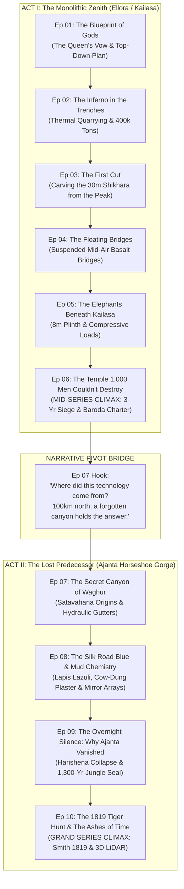

# Definitive 10-Episode Series Roadmap & Narrative Architecture
**Channel Web-Series**: *Ajanta & Ellora: The Subterranean Titans*  
**Channel**: `thecuriousity-kills-thecat`  
**Date**: October 12, 2026  
**Status**: APPROVED  

---

## 1. Executive Summary & Channel Objectives

The primary goal of this YouTube documentary web-series is to produce high-retention, broadcast-grade, monetizable content that achieves maximum viewer retention, drives organic algorithm discovery, and delivers the 4,000-hour public watch time required for full YouTube monetization.

Rather than presenting an uncoordinated anthology of ancient caves, this design locks in a **10-Episode Definitive Narrative Arc**. The series covers the twin UNESCO subterranean wonders of Maharashtra: **Ellora (Cave 16 Kailasa)** and **Ajanta (The Lost Horseshoe Gorge)**. 

The narrative is engineered around two distinct emotional and dramatic peaks:
1. **The Mid-Series Engineering Climax (Episode 06)**: The monolithic impossibility of Kailasa Temple and its survival against Aurangzeb's 3-year military siege.
2. **The Narrative Pivot Hook (Episode 07)**: Reframing Ajanta as the older, 700-year technological predecessor where ancient artisan guilds first mastered the rock-carving techniques that made Kailasa possible.
3. **The Grand Series Finale Climax (Episode 10)**: The dramatic 1819 tiger hunt rediscovery by Captain John Smith, the tragic Victorian fires that destroyed early documentation, and the modern 3D LiDAR point cloud scans that unveil the internal secrets of the mountain.

---

## 2. Master 10-Episode Progression Spectrum

---

## 3. Episode-by-Episode Detailed Blueprint

### Act I: The Monolithic Zenith (Ellora / Kailasa)

#### Episode 01: The Blueprint of Gods
* **Core Topic**: The inception of Cave 16, the Deccan Traps volcanic geology, the legend of the Queen's Vow (*Katha-Kalpataru*), and Chief Architect Kokasa's inverted top-down methodology.
* **Duration**: 7m 45s (Produced).
* **Viral Hook**: *"How do you build a 10-story temple out of solid mountain rock without adding a single brick or erecting a single wooden scaffold?"*
* **Companion Shorts**:
  1. *Short 01*: The Queen's Vow that defied architectural physics.
  2. *Short 02*: The Billion Dollar Mountain: 400,000 tons of missing stone.

#### Episode 02: The Inferno in the Trenches
* **Core Topic**: Bulk extraction mechanics, thermal shock quarrying (fire-setting and water quenching), moisture-swelling wooden split-wedges, and basket relays removing 400,000 metric tons of basalt.
* **Duration**: 8m 12s (Produced).
* **Viral Hook**: *"Ancient quarrymen didn't have dynamite. They used fire, cold water, and dry wood to split a mountain in half."*
* **Companion Shorts**:
  1. *Short 01*: The Fire Secret of the Deccan quarrymen.
  2. *Short 02*: Where did 400,000 tons of quarried basalt go?

#### Episode 03: The First Cut
* **Core Topic**: Isolation of the central basalt monolith; carving the 30-meter *Vimana* (spire) and *kalasha* finial from the hilltop downward; zero margin for error in subtractive carving.
* **Duration**: 8m 30s (Produced).
* **Viral Hook**: *"In normal construction, a mistake can be rebuilt. In monolithic carving, a single wrong chisel strike ruins the entire temple forever."*
* **Companion Shorts**:
  1. *Short 01*: The First Cut that could not fail.
  2. *Short 02*: Carving from the sky downward.

#### Episode 04: The Floating Bridges
* **Core Topic**: Subtractive hollow engineering; carving mid-air suspended rock bridges connecting the entrance *Gopuram*, the Nandi pavilion, and the upper *Sabha Mandapa*.
* **Duration**: 8m 45s (Produced).
* **Viral Hook**: *"Look closely at this bridge: it was not placed here. The empty air beneath it was carved away by hand."*
* **Companion Shorts**:
  1. *Short 01*: The Bridge in Midair.
  2. *Short 02*: The Bridge That Defied Gravity.

#### Episode 05: The Elephants Beneath Kailasa
* **Core Topic**: The 8-meter-high *Adhishthana* plinth; structural load distribution across the courtyard floor; continuous running friezes of life-sized war elephants and lions.
* **Duration**: ~8m 30s (Asset & Mix Stage).
* **Viral Hook**: *"These stone elephants aren't just decorative statues—they are the literal shock absorbers holding up the weight of an entire mountain."*
* **Companion Shorts**:
  1. *Short 01*: The Elephants That Carry a Mountain.
  2. *Short 02*: The Physics of the 8-Meter Adhishthana Plinth.

#### Episode 06: The Temple That 1,000 Men Couldn't Destroy [Mid-Series Climax]
* **Core Topic**: Structural invincibility; the 1682 military siege ordered by Mughal Emperor Aurangzeb; 3 years of failed demolition; the 812 CE Baroda Copper Plate inscription (*"Katham-akrita yan-maya"*).
* **Duration**: 10m 24s (Master Rendered & Passed 5/5 Quality Gates).
* **Viral Hook**: *"In 1682, an emperor sent 1,000 men with sledgehammers and fires to level this temple. Three years later, they gave up. Here is why."*
* **Companion Shorts**:
  1. *Short 01*: The Sky Bridge That Shouldn't Exist.
  2. *Short 02*: The Temple That 1,000 Men Couldn't Destroy.

---

### Act II: The Lost Predecessor (The Secrets of Ajanta)

#### Episode 07: The Secret Canyon of Waghur [The Pivot Bridge]
* **Core Topic**: The shift to Ajanta, 100 km north; why Kailasa's engineers were the heirs to an older 700-year subterranean tradition; early Satavahana Theravada caves (2nd c. BCE); horse-shoe gorge geology; monolithic rainwater diversion channels and *podhi* cisterns.
* **Duration**: ~8m 30s.
* **Viral Hook**: *"Before Kailasa, there was Ajanta: 30 caves hidden inside a horseshoe volcanic chasm so deep it remained invisible to human maps for over a thousand years."*
* **Companion Shorts**:
  1. *Short 01*: The Horseshoe Canyon Hidden from the World.
  2. *Short 02*: How Ancient Monks Engineered Water in a Basalt Gorge.

#### Episode 08: The Silk Road Blue & Mud Chemistry
* **Core Topic**: The Vakataka golden age under Emperor Harishena (460–480 CE); the *Dakshinapatha* trade route; importing rare *lapis lazuli* from Badakhshan, Afghanistan; the 3-layer plaster chemistry (chipped basalt key, cow-dung & rice husk matrix, agate-burnished lime intonaco); sootless mirror lighting arrays.
* **Duration**: ~8m 45s.
* **Viral Hook**: *"How did frescoes made of mud, cow dung, and Afghan blue gems stay vivid in pitch-black caves for 1,500 years without a single drop of torch soot?"*
* **Companion Shorts**:
  1. *Short 01*: The Secret Ingredient in Ancient Frescoes: Fermented Cow Dung.
  2. *Short 02*: Lighting a Pitch-Black Cave with Bronze Mirrors.

#### Episode 09: The Overnight Silence: Why Ajanta Vanished
* **Core Topic**: The sudden cessation of work c. 477–480 CE; Emperor Harishena's sudden death and the Asmaka insurrection; unfinished caves (Caves 24, 29) showing half-chiseled rock benches and abandoned pillars; mudslides, flash floods, and dense teak jungle sealing the gorge for 13 centuries.
* **Duration**: ~8m 30s.
* **Viral Hook**: *"Within 20 years, hundreds of master artists carved 20 massive palaces into the cliff. Then, in one month, every chisel was dropped, and the entire gorge went completely silent."*
* **Companion Shorts**:
  1. *Short 01*: The Unfinished Caves Frozen in Time.
  2. *Short 02*: Why 30 Temples Vanished into the Jungle for 1,300 Years.

#### Episode 10: The 1819 Tiger Hunt & The Ashes of Time [Grand Series Climax]
* **Core Topic**: April 28, 1819 rediscovery by British officer Captain John Smith and teen Bhil scout Krishnamaji; entering Cave 10 through 5 feet of silt and bat guano; the pencil graffiti; the tragic fires that destroyed Major Robert Gill's 20-year canvas replicas (Crystal Palace, 1866) and Griffiths' works (South Kensington, 1885); Italian conservators stripping oxidized shellac; modern 3D terrestrial LiDAR and Ground-Penetrating Radar revealing subterranean structural voids.
* **Duration**: ~9m 30s.
* **Viral Hook**: *"A British officer followed a tiger into a forgotten canyon—and accidentally found a lost civilization. But the tragedy that followed almost erased it again."*
* **Companion Shorts**:
  1. *Short 01*: The Tiger Hunt That Found a Lost Civilization.
  2. *Short 02*: Modern LiDAR Scanners Penetrate Kailasa's Mountain Core.

---

## 4. Production Standards & Operational Channel Laws

All remaining production (Episodes 07 through 10) must strictly comply with the channel's laws defined in [`AGENTS.md`](file:///C:/Sagar/Projects/thecuriousity-kills-thecat/AGENTS.md):

1. **Law 1 & 2 (Google Flow Video Gate)**:
   - Every episode requires 7–10 high-impact kinetic action clips.
   - The agent generates base 16:9 stills into `episodeXX/google_flow_input_images/`, generates a clean prompt sheet, and halts for user video generation. No borrowed or placeholder videos are permitted.
2. **Law 3 (Zero Media Repetition Invariant)**:
   - 0 duplicate visual cuts across an episode; 0 duplicate cuts across the series.
3. **Law 4 & 8 (Audio Integrity & ElevenLabs Voice Profile)**:
   - Official voice: **Adam Stone** (`auq43ws1oslv0tO4BDa7`, `eleven_multilingual_v2`, `stability=0.55`, `similarity_boost=0.80`).
   - Sentence concatenation drift strictly $\le 10.0\text{ ms}$ (enforce 0.00ms).
   - Loudness strictly EBU R128 (-16 LUFS $\pm 1$ LUFS, True Peak $< -1.5\text{ dBFS}$).
4. **Law 9 (Strict Infographic Ceiling)**:
   - Maximum 1 to 2 technical diagrams per episode. 0% text dossier slides or bullet lists.
5. **Law 11 (Zero Content ID Claim Invariant)**:
   - Only YouTube Audio Library tracks (Patrick Patrikios, etc.) or bespoke procedural synthesis. 0% third-party stock audio.
6. **Law 6, 7 & 10 (Companion Shorts Standards)**:
   - 2 Shorts per episode, multi-cut pacing (5–7 cuts, 2.5s–7.5s per cut).
   - Frosted backdrop framing for 16:9 footage in 9:16 vertical canvas.
   - Vertical Subtitle Safe Zone: `PlayResX=1080,PlayResY=1920,FontSize=56,Outline=4,Alignment=2,MarginV=420`.
   - Dedicated 9:16 vertical thumbnails in `thumbnail/` under 2.0 MB adhering to the 3-Word Hook Rule.

---

## 5. Execution Roadmap

| Milestone | Target Deliverable | Status |
| :--- | :--- | :--- |
| **Milestone 1** | Episode 06 Master Assembly & Publish Kit | **COMPLETED & AUDITED (3.0/3.0)** |
| **Milestone 2** | Episode 05 Master Polish & Publish Kit | **READY FOR AUDIT & MASTER PREVIEW** |
| **Milestone 3** | Episode 07 Script, Storyboard & Google Flow Prep | **PENDING (Next Step)** |
| **Milestone 4** | Episode 08 Script, Storyboard & Google Flow Prep | **PENDING** |
| **Milestone 5** | Episode 09 Script, Storyboard & Google Flow Prep | **PENDING** |
| **Milestone 6** | Episode 10 Grand Climax Assembly & Series Packaging | **PENDING (Final Climax)** |
